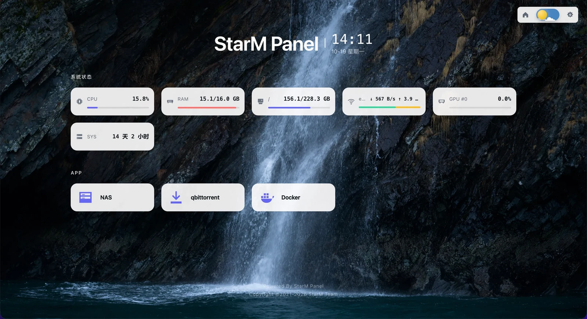

<h1 align="center">StarM Panel</h1>

<p align="center">一款跨平台的轻量级自托管导航页</p>
<p align="center">支持windows macos linux</p>

<p align="center">
  
</p>

## 下载

前往 [Releases](https://github.com/BrokenDreamStar/StarM-Panel/releases/latest) 页面下载对应平台的归档：
**macOS / Linux 是 `.tar.gz`，Windows 是 `.zip`**。归档里只有一个可执行文件，解开即可运行。
面板的「检查更新」也走同一份归档，会自动替换程序本身。

```bash
# Linux x64（arm64 把文件名里的 x64 换成 arm64）
curl -fLO https://github.com/BrokenDreamStar/StarM-Panel/releases/latest/download/starm-panel-v0.1.5-linux-x64.tar.gz
tar xzf starm-panel-v0.1.5-linux-x64.tar.gz
```

## 启动

> 版本号替换为下载的实际版本号，x64 / arm64 根据你的平台架构选择。

### Linux

```bash
chmod +x starm-panel-v0.1.5-linux-x64
./starm-panel-v0.1.5-linux-x64
```

### macOS

```bash
tar xzf starm-panel-v0.1.5-darwin-arm64.tar.gz
chmod +x starm-panel-v0.1.5-darwin-arm64
./starm-panel-v0.1.5-darwin-arm64
```

### Windows

解压 `starm-panel-v0.1.5-windows-x64.zip`，双击里面的 `starm-panel-v0.1.5-windows-x64.exe`，或在 PowerShell 中运行：

```powershell
.\starm-panel-v0.1.5-windows-x64.exe
```

### 打开面板

启动后终端会打印监听地址：

```
  StarM Panel v0.1.5
  ────────────────────────────────────────
  监听    0.0.0.0:3002
  访问    http://localhost:3002
  运行时  Bun 1.4.2 (linux-x64)
```

浏览器打开 **http://localhost:3002** 或同一局域网内的其它设备访问 `http://<这台机器的 IP>:3002`

> **macOS**：从浏览器下载的程序可能会被 Gatekeeper 拦下，放行一次即可：`xattr -d com.apple.quarantine starm-panel-v0.1.5-darwin-arm64`。
>
> **Windows**：若弹出「Windows 已保护你的电脑」，点「更多信息 → 仍要运行」。

## 启动参数

```
用法：starm-panel [参数]

  --port <number>        监听端口（默认 3002）
  --host <string>        监听地址（默认 0.0.0.0）
  --data-dir <path>      数据目录（默认 ~/.starm-panel）
  --reset-auth           重置登录密码
  --version              显示版本
  --help                 显示帮助
```

## 从源码运行

需要 [Bun](https://bun.sh) ≥ 1.4：

```bash
bun install
bun run dev
bun run build
```

## 更新日志

见 [CHANGELOG.md](CHANGELOG.md)。

## 许可证

[GPL-3.0](LICENSE)
